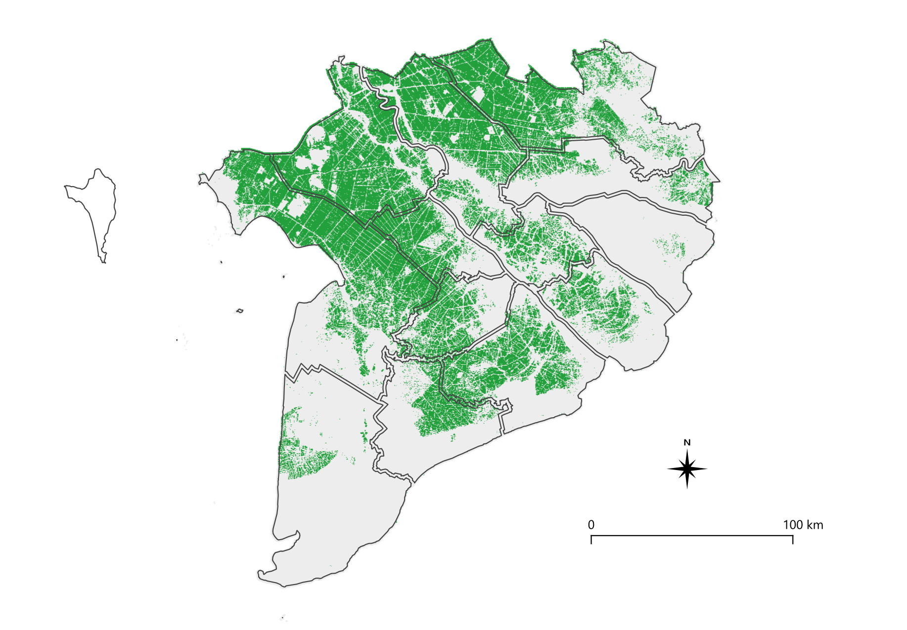
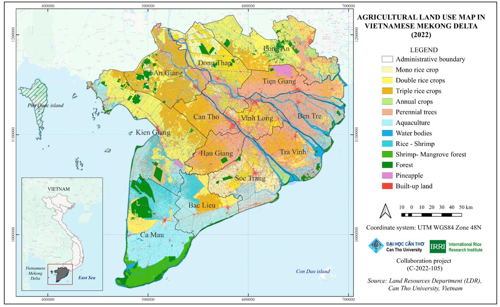

# Rice Mapping using Satellite Images
[](https://github.com/elmiranda00/where-is-my-rice/actions/workflows/ci.yml)


A rice / non-rice map of the Mekong Delta in Vietnam, mapped at a 10 m resolution, using Sentinel-1 radar data and an SVM classifier.

**Check the zoomable map here:** https://elmiranda00.github.io/where-is-my-rice/ 


## Mapping process

1. **Training data.** 600 labelled points (300 rice, 300 non-rice) in and around a single province in the delta from 2020 (An Giang, about 9.9–10.5° N, 104.9–105.8° E)
2. **Satellite data.** Sentinel-1 images for 2020 via the Microsoft Planetary Computer STAC API. (Radar sees through clouds and picks up backscatter pattern from flooded rice fields over seasons)
3. **Feature Engineering.** Consider the median value over 12-day windows (taken as a proxy for a phase in the rice growing process) -> Apply a 9 × 9 median filter over this composite to reduce the speckle effect -> four bands per pixel (VV, VH, VH/VV ratio, radar vegetation index RVI = 4·VH / (VV + VH)) > calcualte five statistics (mean, std. dev. min, max, range) for each band across the year i.e. across the windows.
4. **Model.** Support vector machine (SVM) with RBF kernel and spatial cross-validation to ensure the model is always tested on unseen sites
5. **Scaling up the model for the entire delta** The Delta is split into 840 tiles of 10 × 10 km. Each tile is one task in a Cloud Run Job on Google Cloud. Each task writes a Cloud Optimized GeoTIFF (COG) to Cloud Storage.
6. **Compiling and publishing the map** The tiles are joined into one mosaic and clipped to the province boundaries, then converted to PMTiles for the web map. The rice area detected per province from my model is compared with figures from Phan et al. (2024), which gives rice land per province for 2022 ([see citation](#data-sources-and-licences)).

### Map comparison

| (a) This study: Sentinel-1 + SVM, 2020 | (b) Report: land use, 2022 |
|:---:|:---:|
|  |  |

*(a) Rice fields detected from my work; considers all rice-systems together (i.e. mono, double and triple). Province Boundaries using [GADM 4.1](#data-sources-and-licences)*

*(b) Map of land use from [Phan, K.D. et al. (2024)](https://hdl.handle.net/10568/151791). The report uses clustering and Random Forest to identify different land use ares. For rice, they display a split based cropping systems; compare total rice extent (yellow + orange shaded areas), not individual classes.*

For a province-by-province comparison of rice area, see [Results](#rice-area-per-province-map-2020-vs-reference-report-2022).


## Results

### Model validation (spatially grouped cross-validation, 600 points)

| Accuracy | Precision | Recall | F1 | ROC AUC |
|---|---|---|---|---|
| 0.83 | 0.75 | 1.00 | 0.85 | 0.99 |

### Rice area per province: my map (based on 2020 training data) vs reference report (2022)

Note: Reference rice land = single + double + triple rice. I have excluded Rice-shrimp land.

| Province | Map (ha) | Reference (ha) | Difference |
|---|---:|---:|---:|
| Long An | 205,304 | 329,923 | −37.8% |
| Tiền Giang | 42,161 | 42,422 | −0.6% |
| Bến Tre | 3,664 | 5,951 | −38.4% |
| Trà Vinh | 50,401 | 65,498 | −23.1% |
| Vĩnh Long | 45,350 | 48,808 | −7.1% |
| Đồng Tháp | 187,265 | 172,003 | +8.9% |
| An Giang | 215,623 | 220,634 | −2.3% |
| Kiên Giang | 259,751 | 272,388 | −4.6% |
| Cần Thơ | 70,105 | 83,434 | −16.0% |
| Hậu Giang | 63,498 | 59,437 | +6.8% |
| Sóc Trăng | 113,268 | 121,720 | −6.9% |
| Bạc Liêu | 51,255 | 61,548 | −16.7% |
| Cà Mau | 24,672 | 39,577 | −37.7% |
| **Full Mekong Delta** | **1,332,318** | **1,523,343** | **−12.5%** |

The map finds 12.5% less rice than the report over the whole Delta. Seven provinces are within ±9% of the reference. The largest shortfalls are in Long An, Bến Tre and Cà Mau (about −38% each) and Trà Vinh (−23%), which are far from the training data sites.


## Limitations

- **Small training area.** All 600 trianing labels come from 7 sites near An Giang spanning about 3,000 km² if we draw around all points; The validation scores only describe that area. The full delta map covers 39,700 km², which is about 13 times larger, so roughly 92% of the mapped area lies outside the labelled area.
- **Aquaculture.** Shrimp ponds might have been detected as rice crop by our model (as they are usually flooded, might lead to a similar backscatter in certain times of the year) Not enough training data to distinctly classify them corectly.
- **Different years.** The model builds a map based on 2020 training data; the reference figures are for 2022.


### Bug found and fixed: no-data gaps

The first run left large gaps in the mapped area (about 354,000 ha i.e. 9% of the Delta without a prediction) The cause: Planetary
Computer fills the area outside each radar scene with −32768, not with "missing" (NaN). The composites mixed −32768 with real values, and features became invalid. Fix: Applied a fill value for -32768 at the time of data loading.

## If you'd like to run it yourself

```
uv sync
uv run pytest
uv run ricemap list-tiles                       # tiles in the study area
uv run ricemap train                            # training table, CV, model.joblib
uv run ricemap predict-tile --tile-id <id>      # one tile, locally
```
Set `STORAGE_URI=gs://<bucket>` to read and write in Cloud Storage instead of `./outputs`.
Cloud setup: see `infra/` (copy `terraform.tfvars.example` to `terraform.tfvars`).

## Data sources and licences

- Sentinel-1 RTC: Copernicus Sentinel data 2020, processed by Microsoft Planetary Computer.
- Province boundaries: GADM 4.1, level 1 (gadm.org). Not redistributed here due to licensing restrictions: download it to `data/raw/` yourself.
- Reference rice land 2022: Phan, K. D., Nguyen, T. C., Pham, D. T., Nguyen, K. D., Nguyen, T. N., Tran, G. H., & Phan, H. V. (2024). *Report on land use analysis for 13 provinces in Vietnamese Mekong Delta in 2022*. Can Tho University. https://cgspace.cgiar.org/items/a5d9253a-4820-4868-bce5-32bbe8441741

